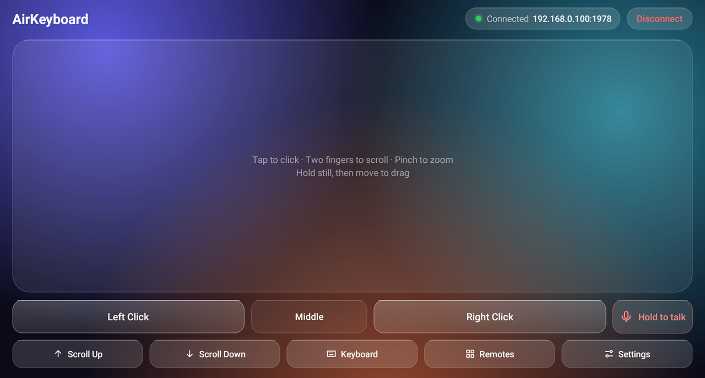
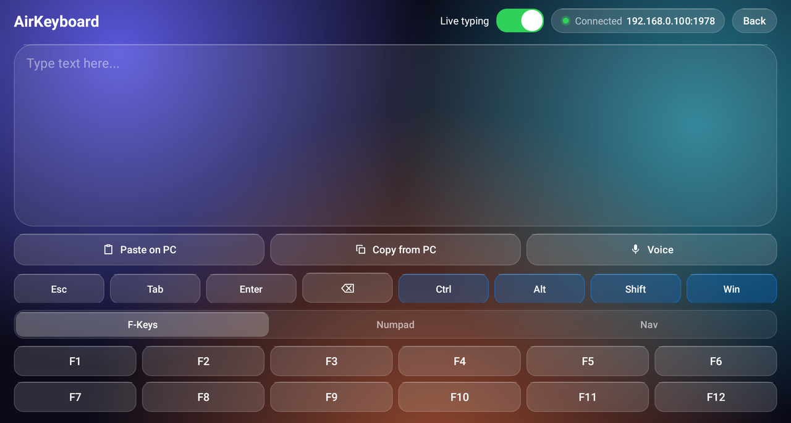
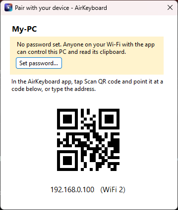
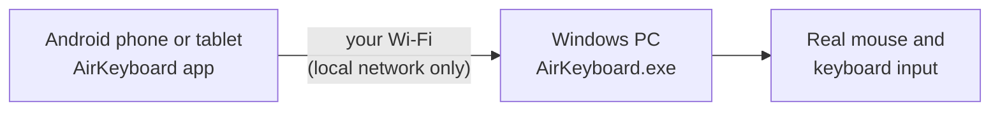

<p align="center"></p>

<h1 align="center">AirKeyboard</h1>

<p align="center">
  <b>Turn your Android phone or tablet into a wireless trackpad and keyboard for your Windows PC.</b><br>
  Free and open source. No ads, no accounts, no in-app purchases.
</p>

<p align="center">
  <a href="https://github.com/SummitAnthony/AirKeyboard/releases/latest/download/AirKeyboard-1.0.3.apk"></a>
  <a href="https://github.com/SummitAnthony/AirKeyboard/releases/latest/download/AirKeyboard.exe"></a>
</p>

<p align="center">
  Android 7.0 or later (phones and tablets) · Windows 10 or 11 (64-bit) ·
  <a href="https://github.com/SummitAnthony/AirKeyboard/releases">All downloads</a>
</p>


https://github.com/user-attachments/assets/2f6e491a-0e7b-4d63-8464-b25123897356


<p align="center">
  
  
  
</p>

## What it does

You install two small apps: one on your phone or tablet, one on your PC. Then it works like a
laptop trackpad and keyboard for the PC, over your home Wi-Fi.

- **Mouse:** click, right-click, scroll, zoom and drag with your fingers. Or turn the device in
  the air to move the pointer (air mouse).
- **Keyboard:** type with your device's normal keyboard and the letters appear on the PC as you
  type. Or just speak (voice input).
- **Copy and paste:** send a block of text to the PC in one go, or copy text on the PC and get
  it on the device.
- **Shortcut keys:** Ctrl, Alt, Shift and Win always on screen, plus F1 to F12, a number pad and
  arrow keys.
- **Remote control:** media and volume keys (the device's volume buttons work too), slides in
  presentations, switching between open windows, opening saved websites on the PC, and shut
  down, restart, sleep, log off or lock (each asks first).
- **Easy connection:** the app finds your PC by itself, remembers it, and reconnects on its own
  if the connection drops. An optional password keeps others out.

AirKeyboard works on Android phones and tablets, held upright or sideways. A version for iOS
may come later.

## Set it up

It takes a few minutes. You need:

- a Windows 10 or 11 PC (64-bit) and an Android phone or tablet (Android 7.0 or later),
- both on the **same Wi-Fi network** (the PC can also be plugged into the same router by cable).

### Step 1: Install the PC app

1. Download **AirKeyboard.exe** with the blue button above.
2. Make a folder for it, for example `C:\Users\<your name>\AirKeyboard`, and move the file there.
   Don't run it from your Downloads folder.
3. Double-click **AirKeyboard.exe**. Windows may show a blue box saying **"Windows protected
   your PC"**, because the app isn't signed with a paid certificate. Click **More info**, then
   **Run anyway**. (If your browser warns about the download, choose **Keep**.)
4. AirKeyboard asks to add a Windows Firewall rule so the device can reach the PC. Click **OK**,
   then **Yes** on the Windows prompt.
5. Done. AirKeyboard now runs in the **system tray**, next to the clock. If you don't see its
   icon, click the small **^** arrow there.

### Step 2: Install the Android app

1. On the device, open this page and tap the green **Download Android app** button.
2. Open the downloaded file. Android asks you to allow your browser to **install unknown apps**:
   allow it, go back, and tap **Install**.
3. If Google Play Protect says the app is unknown, tap **Install anyway**.
4. You can turn the "install unknown apps" permission off again afterwards (Settings > Apps >
   your browser > Install unknown apps).

### Step 3: Connect

1. Open **AirKeyboard** on the device. Within a few seconds it finds your PC and connects. (If
   it finds more than one PC, tap yours.)
2. PC not in the list? On the PC, **double-click the AirKeyboard tray icon** to open the pairing
   window. In the app, tap **Scan QR Code** and point the camera at the code. Or type the
   address shown under the code.

That's it: your device is now the PC's trackpad and keyboard.

### Step 4 (recommended): Set a password

Without a password, anyone on your Wi-Fi who has the app can control your PC. To set one,
right-click the AirKeyboard tray icon and choose **Set password…** (at least 8 characters). The
device asks for it the next time it connects, and can remember it.

## Using the trackpad

| On the device | On the PC |
|---|---|
| Tap with one finger | Click |
| Tap with two fingers | Right-click |
| Slide two fingers | Scroll |
| Pinch | Zoom |
| Hold your finger still for half a second, then move | Drag (the pad buzzes and changes color) |
| Move three fingers | Drag |

In the app's settings you can turn on natural scrolling, change the scroll speed and pointer
acceleration, swap the buttons for left-handed use, turn three-finger drag on or off, and pick a
blue or red theme.

## Staying safe

- **Use AirKeyboard on your own Wi-Fi, with your own PC.** On networks you share with strangers
  (cafés, hotels, airports), anyone there with the app could control your PC unless you set a
  password.
- **Set a password** (step 4). Choose one that isn't a common word or name; longer is better.
- **The connection is not encrypted.** Someone who can watch your Wi-Fi traffic could see what
  you type and paste. Don't type sensitive things, such as passwords, through AirKeyboard on
  public or shared Wi-Fi.
- **Only devices on your local network can reach the PC**, not the internet (unless you set
  your router to forward the ports, which you shouldn't).
- **On a laptop you take to other places:** set a password, or quit AirKeyboard there and leave
  **Start with Windows** off.
- **Voice input** uses your device's own speech recognition (often Google's), which may send your
  voice online. Apart from that, AirKeyboard only talks to your PC.

<details>
<summary><b>More detail for the technically curious</b></summary>

- **Without a password**, any device on the same network can send mouse and keyboard input to
  the PC, and read the PC's clipboard and the titles of its open windows. The Windows Firewall
  rules (TCP 1978, UDP 1978 and 2008, inbound) only allow devices on your local subnet. They
  apply on every network type, including networks Windows calls Public, because Windows often
  marks home Wi-Fi as Public.
- **With a password**, other devices can no longer send input: every message carries a
  cryptographic tag (HMAC-SHA256) that only a device that knows the password can make, and
  replayed messages are rejected. The device also checks that the PC knows the password.
- **Traffic is only obfuscated, not encrypted**, in both modes (a simple XOR scheme). Someone
  capturing it can read what you type and paste (including passwords you type into the PC), and
  the PC clipboard and window titles the device fetches.
- **A captured login lets an attacker guess the password offline.** A long password that is not
  a common word makes that impractical.
- **Wrong passwords:** after 5 from the same device, that device is locked out for 30 seconds,
  doubling up to 10 minutes. The PC forgets the failures an hour after the last one.
- **The PC stores only a salted PBKDF2 key**, never the password itself. That key is enough to
  log in, though, so keep its file (`%APPDATA%\AirKeyboard\config.json`) as private as the
  password.
- **Pasted text** is kept out of Windows clipboard history and cloud clipboard sync. **Typed
  text** is not written to the PC's logs (only the names of keys such as Enter or Ctrl+C).
- **Power commands, opening websites and closing windows** work only from a connected (and, with
  a password, logged-in) device; they can do what any keyboard user could do.

The full protocol is described in [docs/PROTOCOL.md](docs/PROTOCOL.md).

</details>

## If something doesn't work

<details>
<summary><b>The PC doesn't show up in the app</b></summary>

- Check that the device and the PC are on the same network. Guest Wi-Fi networks usually keep
  devices apart; use your main network.
- Some routers have a setting called "AP isolation" or "client isolation" (sometimes on by
  default for 5 GHz or mesh networks). Turn it off in the router settings, or connect the PC by
  cable.
- Some routers block the way the app searches for PCs. Use the QR code or type the PC's address
  instead (step 3).
- A VPN on the PC or the device can get in the way. Pause it and try again.

</details>

<details>
<summary><b>The app finds the PC but won't connect (or nothing happens)</b></summary>

- The firewall rules may be missing, for example if you clicked **No** on the Windows prompt.
  Right-click the AirKeyboard tray icon, choose **Set up firewall…** and accept the prompt (this
  item only shows while the rules are missing). Or add the rules yourself from an administrator
  terminal:
  ```
  netsh advfirewall firewall add rule name="AirKeyboard (TCP 1978)" dir=in action=allow protocol=TCP localport=1978 remoteip=localsubnet
  netsh advfirewall firewall add rule name="AirKeyboard (UDP 1978,2008)" dir=in action=allow protocol=UDP localport=1978,2008 remoteip=localsubnet
  ```
- Other firewalls or antivirus programs have their own rules; allow `AirKeyboard.exe` there.
- The device and the PC must be on the same part of the network. If the PC's address starts
  with `192.168.1.` and the device's with `192.168.0.` (common with a second router or a range
  extender), the firewall blocks the device. Connect both to the same router.

</details>

<details>
<summary><b>The mouse works, but some windows ignore it</b></summary>

Windows doesn't let normal programs control programs running as administrator (Task Manager,
admin terminals, some installers). If you need that, quit AirKeyboard (right-click the tray
icon > **Quit**), then right-click `AirKeyboard.exe` and choose **Run as administrator**. Set a
password first: while it runs as administrator, every device that can connect gets
administrator-level control.

</details>

<details>
<summary><b>Uninstall</b></summary>

1. Right-click the AirKeyboard tray icon, untick **Start with Windows**, then choose **Quit**.
2. Delete `AirKeyboard.exe`.
3. Remove the firewall rules from an administrator terminal (they stay open otherwise):
   ```
   netsh advfirewall firewall delete rule name="AirKeyboard (TCP 1978)"
   netsh advfirewall firewall delete rule name="AirKeyboard (UDP 1978,2008)"
   ```
4. Delete the settings and logs folders, `%APPDATA%\AirKeyboard` and `%LOCALAPPDATA%\AirKeyboard`.

On the device, uninstall the app as usual.

</details>

## For developers

### How it works



The device app finds the PC with a UDP broadcast, opens a TCP session to it, then sends mouse
and keyboard commands as small UDP and TCP messages. The PC app turns them into real Windows
input. The protocol (discovery, handshake, commands, password login, paste and system commands)
is described in [docs/PROTOCOL.md](docs/PROTOCOL.md).

### Built with

- **Android app** (`android-app/`): Kotlin, Android Views, coroutines, ZXing for QR scanning.
- **Windows app** (`windows-server/`): C# on .NET 8, a Windows Forms tray app using the Win32
  `SendInput` API, QRCoder for the pairing code.
- **Security:** password login with PBKDF2-SHA256 and HMAC-SHA256, replay protection and
  lockout after wrong passwords.
- **Tests:** unit tests, on-device end-to-end tests that drive the real app against the real PC
  app, and PC-side protocol and stress tests. See [docs/TESTING.md](docs/TESTING.md).

### Build from source

**Android app:** JDK 17 and the Android SDK (platform 35). Point Gradle at the SDK with
`ANDROID_HOME` or a `local.properties` file (`sdk.dir=...`).

```
cd android-app
./gradlew assembleDebug        # Windows: .\gradlew.bat assembleDebug
# app/build/outputs/apk/debug/app-debug.apk
```

**Windows app:** the .NET 8 SDK.

```
cd windows-server
dotnet build
dotnet publish        # one self-contained publish\AirKeyboard.exe (settings are in AirKeyboard.csproj)
```

The icons are generated from one geometry by `python branding/make_icons.py` (needs Pillow and
NumPy).

## About

AirKeyboard is an independent, open-source project. The Android app and `AirKeyboard.exe` are
made and tested to work with each other; using either one with other apps or servers isn't
supported.

## License

MIT; see [LICENSE](LICENSE). Third-party components and their licenses:
[THIRD-PARTY-NOTICES.md](THIRD-PARTY-NOTICES.md).
